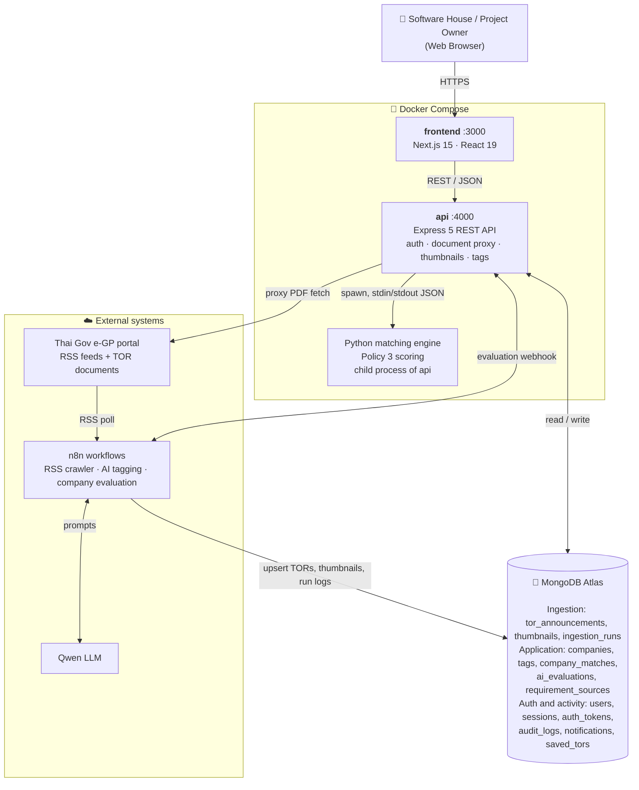
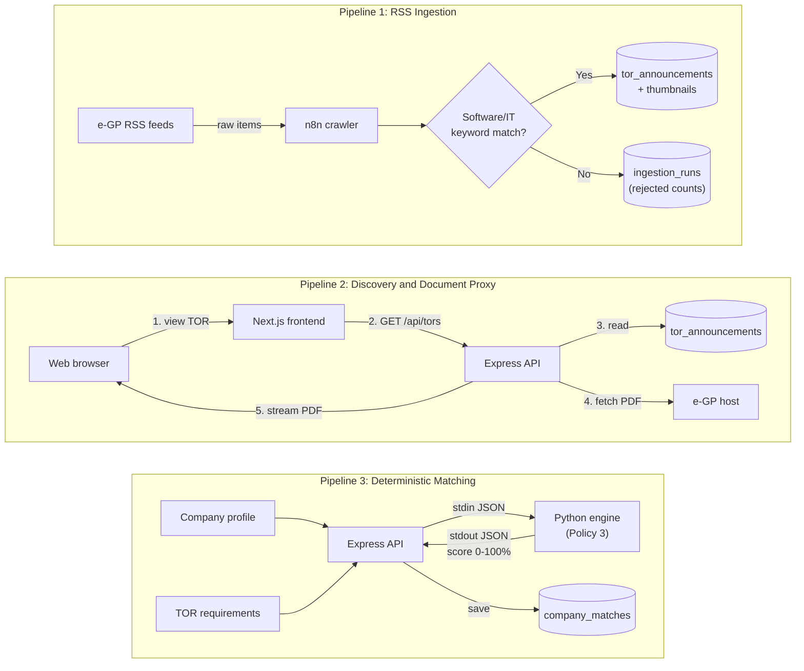
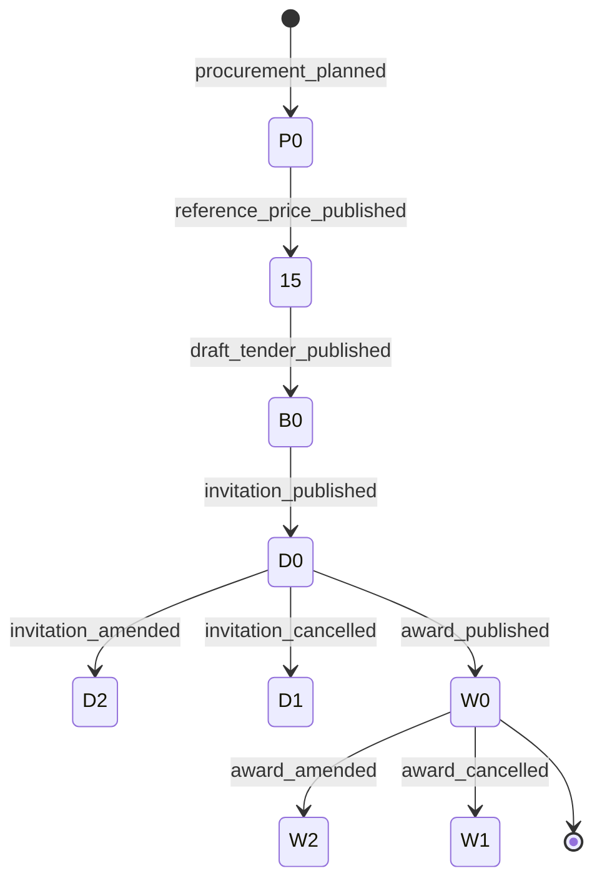
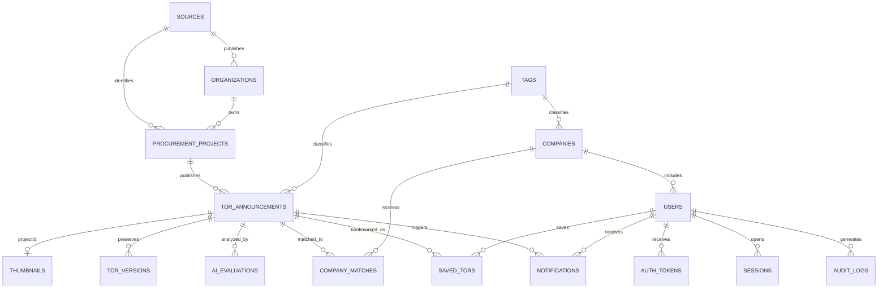

# TOR Software Platform (Bangkok-TOR)

**Bangkok-TOR** is an end-to-end web platform designed for discovering, tracking, and analyzing Thai Government Terms of Reference (TOR) and procurement announcements (from the Electronic Government Procurement / e-GP system). The platform automatically extracts technical criteria, evaluates contractor qualifications, and performs deterministic requirement matching between government opportunities and Thai software houses.

### Key Capabilities
- **Nationwide IT Procurement Monitoring**: Ingestion pipelines continuously track and filter Thai government procurement announcements focusing specifically on IT, software development, cloud infrastructure, and digital systems.
- **Deterministic Requirement Matching (Policy 3)**: Uses a standalone Python scoring engine that weighs mandatory clauses, preferred criteria, and vendor evidence levels (`claimed`, `experienced`, `verified`) to generate transparent, auditable match scores (0–100%) rather than speculative AI guesses.
- **AI-Powered Evaluation**: Integrates n8n workflows and large language models (Qwen) for automated criteria extraction from procurement PDFs and personalized contractor gap analysis.
- **Secure Document Proxy & WebP Thumbnails**: On-the-fly streaming of official government procurement PDFs and WebP first-page document previews, bypassing CORS limitations while preventing upstream document credential exposure.
- **Controlled Tagging Vocabulary**: Centralized taxonomy categorizing technical specifications and contractor requirements with alias resolution.

### Technology Stack
- **Frontend**: Next.js 15, React 19, TypeScript, TailwindCSS.
- **Backend API**: Node.js (>=24), Express 5, Native MongoDB Driver (7.x), JWT authentication (HMAC-SHA256) with refresh rotation.
- **Database**: MongoDB Atlas with strict JSON schema validators and unique indexes.
- **Matching Engine**: Python 3 subprocess (`tor-backend/matching/engine.py`), weighted clause policy over `stdin`/`stdout`.
- **Workflow Automation & AI**: n8n workflow engine (`https://n8n.actvee.com/`), Qwen LLM for requirement/tag extraction.
- **Containerization**: Docker & Docker Compose.

---

## Installation and Setup

### Prerequisites
- **Node.js**: Version 24 or newer
- **npm**: Version 10 or newer
- **Python**: Version 3.10 or newer (for local matching engine execution)
- **MongoDB**: MongoDB Atlas cluster or local MongoDB 7.0+
- **Docker & Docker Compose**: Optional, for containerized execution

### Step 1: Configure Environment Variables

#### Backend (`tor-backend/.env`)
Copy `tor-backend/.env.example` to `tor-backend/.env`:
```bash
cp tor-backend/.env.example tor-backend/.env
```

| Variable | Required | Description | Example / Default |
| :--- | :---: | :--- | :--- |
| `NODE_ENV` | Yes | Runtime environment (`development` or `production`) | `development` |
| `PORT` | Yes | Express API listening port | `4000` |
| `FRONTEND_ORIGIN` | Yes | Allowed CORS frontend origins | `http://localhost:3000,http://127.0.0.1:3000` |
| `MONGODB_URI` | Yes | MongoDB Atlas connection string | `mongodb+srv://<user>:<password>@<cluster>.mongodb.net/` |
| `MONGODB_DB_NAME` | Yes | Target database name | `tor_software` |
| `AUTH_ACCESS_SECRET` | Yes | HMAC-SHA256 secret (min 32 characters) | Generated via `crypto.randomBytes(48).toString('hex')` |
| `AUTH_ACCESS_TTL_SECONDS` | No | JWT access token lifespan | `900` (15 mins) |
| `AUTH_REFRESH_TTL_DAYS` | No | Session refresh token lifespan | `7` |
| `AUTH_PASSWORD_RESET_TTL_MINUTES` | No | Password reset token expiration | `30` |
| `LOGIN_MAX_ATTEMPTS` | No | Failed attempts before lockout | `5` |
| `LOGIN_LOCK_MINUTES` | No | Account lockout duration | `15` |
| `AI_REQUIREMENTS_TOKEN` | Optional | Shared token for AI worker endpoints (32+ chars) | `<token>` |
| `TOR_EVALUATION_WEBHOOK_URL` | Optional | n8n webhook URL for company evaluation | `https://n8n.taamtera.com/webhook/eval` |
| `TOR_EVALUATION_WEBHOOK_TOKEN` | Optional | Shared auth token for the n8n evaluation webhook | `<token>` |
| `TOR_EVALUATION_TIMEOUT_MS` | No | Timeout for evaluation webhook (ms) | `1920000` |
| `MATCH_ALERT_WORKER_ENABLED` | No | Background worker that evaluates new matches | `true` |
| `MATCH_ALERT_INTERVAL_MS` | No | Worker polling interval | `60000` |
| `MATCH_ALERT_EMAIL_ENABLED` | No | Send match emails (users must also opt in) | `false` |
| `EMAIL_DELIVERY` | No | `smtp` for Gmail or `console` for local dev | `smtp` |
| `SMTP_HOST` / `SMTP_PORT` / `SMTP_SECURE` | If smtp | SMTP server settings | `smtp.gmail.com` / `465` / `true` |
| `SMTP_USER` / `SMTP_PASSWORD` / `EMAIL_FROM` | If smtp | Google App Password credentials | `<email>` / `<app-password>` |
| `MATCHING_PYTHON_EXECUTABLE` | No | Path to Python 3 binary (defaults to system PATH) | `python3` |
| `MATCHING_DEMO_ENABLED` | No | Demo-data scoring (`tor_software_test` only) | `false` |

> Never commit `.env` files or put `MONGODB_URI` / secrets in frontend variables.

#### Frontend (`frontend/.env.local`, optional)
```dotenv
NEXT_PUBLIC_API_BASE_URL=http://localhost:4000
```

### Step 2: Install Dependencies
```bash
cd tor-backend && npm install
cd ../frontend && npm install
cd ../database-design && npm install
```

### Step 3: Initialize and Verify Database
```bash
cd database-design
npm run db:check                       # Test MongoDB connectivity
npm run db:setup                       # Create schema validators and unique indexes
npm run db:verify                      # Verify collections match contracts
npm run db:verify-enrichment-removed   # Confirm no legacy enrichment fields remain
```
`db:migrate` is a read-only preview by default; keep a backup before using `--apply`. See [`database-design/README.md`](./database-design/README.md).

### Step 4: Run the Application

**Option A: Local development (separate terminals)**
```bash
cd tor-backend && npm run dev     # API on http://localhost:4000
cd frontend && npm run dev        # UI on http://localhost:3000
```

**Option B: Docker Compose**
```bash
docker compose config --quiet
docker compose up --build -d
docker compose ps
docker compose down
```
Health check: <http://localhost:4000/api/health>. See [`DOCKER.md`](./DOCKER.md) for more.

---

## High-Level Container & Dataflow Diagram

### 1. High-Level Container Diagram



### 2. High-Level Dataflow Architecture



**Pipeline 1: RSS Ingestion.** n8n polls e-GP RSS feeds and filters by software/IT title keywords. Every run is logged in `ingestion_runs`. Matches are upserted into `tor_announcements` (keyed by string `projectId`), with WebP previews in `thumbnails`.

**Pipeline 2: Discovery & Document Proxy.** `/api/tors` serves metadata. `/api/thumbnail/:projectId` serves a thumbnail only when its `sourceUrl` matches the project's current `documentUrl`. `/api/tors/documents/:projectId` streams the remote PDF/HTML through the backend.

**Pipeline 3: Deterministic Matching (Policy 3).** Express runs `matching/engine.py` over stdin/stdout. Clause weights: `required` 3, `preferred` 1, `informational` 0. Evidence multipliers: `claimed` 0.5, `experienced` 0.75, `verified` 1.0. Results are stored in `company_matches`.

#### Supporting flows (not diagrammed)
- **Authentication & Profile**: Software houses authenticate against `users` (hashed passwords); sessions live in `sessions`. Company capabilities in `companies` link to controlled `tags` with evidence levels (`claimed`, `experienced`, `verified`).
- **Grounded AI Evaluation**: Document pages are hashed (SHA-256) into `requirement_sources`. n8n asks Qwen for tags/requirements, stored as `suggested` until a reviewer approves.

---

## N8N Workflow and Document Flow

### 1. N8N Workflows

Two exported workflows live in this repository and run on n8n (`https://n8n.actvee.com/`).

#### A. AI Tag Extraction (`n8n-tor-ai-tags.json`)
1. **Capture AI Inputs**: receives parsed text from ingested TOR documents.
2. **Read Canonical Tag Catalog**: reads active tags from MongoDB `tags`.
3. **Build Tag-Aware AI Prompts**: builds prompts containing the known taxonomy.
4. **Qwen Structured Tag Extraction**: HTTP call to Qwen for technologies, certifications, capabilities.
5. **Parse AI and Build Tag Writes**: validates the JSON response and prepares writes.
6. **Upsert Missing Canonical Tags**: adds newly discovered tags to `tags`.
7. **Build Atomic Assignment Append** / **Append Tags and Update AI Fields**: atomically appends assignments to `tor_announcements.tagAssignments` as `suggested`.
8. **Build Verification Query** / **Verify Updated Project Tags**: re-reads the project to confirm the write.

#### B. Company Evaluation (`n8n-tor-company-evaluation.json`)
1. **Webhook**: Express posts the company profile and TOR requirements.
2. **Build Evaluation Prompt**: assembles the prompt.
3. **Enough Data?**: stops early when the input is insufficient.
4. **Qwen Company Evaluation**: LLM assessment of strengths and gaps.
5. **Validate Evaluation Response**: validates the structure.
6. **Respond to Webhook**: returns JSON to the backend.

### 2. Document Flow (Document Stages)

Each project stores the latest observation per stage in `tor_announcements.stageObservations`.



| Code | Status | Meaning |
| :---: | :--- | :--- |
| `P0` | `procurement_planned` | Procurement plan announced |
| `15` | `reference_price_published` | Reference price published |
| `B0` | `draft_tender_published` | Draft tender documents published |
| `D0` | `invitation_published` | Invitation to bid published |
| `D1` | `invitation_cancelled` | Invitation cancelled |
| `D2` | `invitation_amended` | Invitation amended |
| `W0` | `award_published` | Winner announced |
| `W1` | `award_cancelled` | Award cancelled |
| `W2` | `award_amended` | Award amended |

> The diagram shows the typical order. The database keeps only the latest observation per stage, not a full history.
> When different stages share the latest publication date, `status` is `multiple_announcements_same_day` and `statusOrderAmbiguous: true`; each stage is displayed separately. An invitation does not verify that bidding is open (`biddingOpenVerified` is always `false`).
> Retired enrichment fields (`opend`, `province`, `district`, `projectMoney`, `locationFilter`, etc.) are forbidden by the validator and omitted from API responses.

---

## Database Schema

MongoDB Atlas is the only data store. The crawler writes exactly three collections (`tor_announcements`, `thumbnails`, `ingestion_runs`); the others support the application. Full details: [`database-design/docs/schema.md`](./database-design/docs/schema.md).

### Entity Relationship Diagram



MongoDB does not enforce foreign keys; relationships show ownership. Projects are identified by the string `projectId`; MongoDB `_id` stays internal.

### Ingestion Collections
| Collection | Purpose | Key fields |
| :--- | :--- | :--- |
| `tor_announcements` | One document per project, upserted by `projectId` (unique index `uq_tors_project_id`) | `projectId`, `identityScope`, `linkedProjectId`, `title`, `departmentId`, `departmentName`, `procurementMethod`, `publishedAt`, `url`, `documentUrl`, `status`, `statusPublishedAt`, `statusOrderAmbiguous`, `stageObservations`, `titleMatchedKeywords`, `tagAssignments`, `firstSeenAt`, `lastSeenAt` |
| `thumbnails` | One WebP thumbnail per project (unique index `uq_thumbnails_project_id`) | `projectId`, `contentType`, `data` (base64), `sourceUrl`, `sourcePublishedAt`, `width`, `quality`, `size`, `updatedAt` |
| `ingestion_runs` | Per department/stage RSS request logs | `fetchedAt`, `request`, `reportedCount`, `itemsReceived`, `complete`, keyword matched/rejected counts |

### Application Collections
| Collection | Purpose | Key fields |
| :--- | :--- | :--- |
| `tags` | Canonical vocabulary (unique `{category, text}`) | `text`, `category`, `type` (`contractor_requirement` / `specification`), `contractorLabel`, `aliases`, `status` |
| `companies` | Software house profile | `legalName`, `district`, `description`, `technologies`, `certifications`, `qualifications`, `verificationStatus`, `tagAssignments`, `tags` |
| `company_matches` | Company ↔ TOR version comparison | `companyId`, `torId`, `torVersion`, `score`, `evidenceScore`, `status`, `requirementMatches`, `policyVersion`, `computedAt` |
| `ai_evaluations` | AI-derived analysis, kept separate from source facts | `torId`, `torVersion`, `status`, `retryCount`, `requirements`, `summary`, `model` |
| `requirement_sources` | Hashed page-text snapshots used to ground AI citations | `torId`, `torVersion`, `sourceUrl`, `documentHash`, pages, `fetchedAt` |
| `tor_versions` | Immutable TOR snapshots (optional extension) | `torId`, `version`, `contentHash`, `changeType`, `snapshot` |
| `saved_tors` | User bookmarks | `userId`, `torId`, `note`, `followUpStatus` |
| `notifications` | In-app and email alert queue | `eventKey`, `userId`, `type`, `channel`, `status`, `attemptCount`, `nextAttemptAt` |

### Authentication Collections
| Collection | Purpose | Key fields |
| :--- | :--- | :--- |
| `users` | Identity and access | `emailNormalized`, `passwordHash`, `role` (`company_admin`, `company_member`, `project_manager`, `system_admin`), `status`, `companyId`, `notificationPreferences` |
| `sessions` | Refresh sessions | `userId`, hashed refresh token, `status`, `expiresAt` |
| `auth_tokens` | Email verification / password reset / invitations | `type`, `tokenHash`, `expiresAt`, `usedAt`, `revokedAt` |
| `audit_logs` | Security events | actor, event, outcome, request ID, safe metadata |

Optional crawler-support collections (`sources`, `organizations`, `procurement_projects`, `raw_ingestion_items`, `rss_query_state`) are described in the full schema document.

---

## API Routes

All routes are prefixed with `/api`. Protected routes require a valid access token (`Bearer <token>` or authenticated cookie). "Company" means `company_admin` or `company_member`; "PM" means `project_manager`.

### System
| Method | Endpoint | Access | Parameters / Return Example | Description |
| :--- | :--- | :--- | :--- | :--- |
| `GET` | `/api` | Public | **Response**: `{ "service": "TOR Software API", "status": "running", "requestId": "..." }` | Service status and request ID |
| `GET` | `/api/health` | Public | **Response**: `{ "status": "ok", "service": "tor-software-backend", "database": "connected", "timestamp": "2026-11-14T..." }` | Database ping and uptime verification |
| `GET` | `/api/dashboard/stats` | Public | **Response**: `{ "matches": { "total": 45, "avg": 76.5 }, "vendors": 18, "crawls": { "runs": 12, "items": 840 }, "topDemand": [{ "name": "Node.js", "count": 14 }] }` | Aggregate statistics across matches, vendors, and tags |

### Authentication
| Method | Endpoint | Access | Parameters / Return Example | Description |
| :--- | :--- | :--- | :--- | :--- |
| `POST` | `/api/auth/register` | Public | **Body**: `{ email, password, firstName, lastName, phone?, companyName, companySize?, district? }` | Register new user and software house profile |
| `POST` | `/api/auth/login` | Public | **Body**: `{ email, password }` | Authenticate; returns access token and sets refresh cookie |
| `POST` | `/api/auth/refresh` | Public | **Cookie**: `tor_refresh_token` | Issue new access token using refresh token |
| `POST` | `/api/auth/logout` | Public | **Cookie**: `tor_refresh_token` | Invalidate current session and clear cookies |
| `POST` | `/api/auth/logout-all` | Authenticated | None | Revoke all active sessions for current user |
| `POST` | `/api/auth/forgot-password` | Public | **Body**: `{ email }` | Generate and dispatch password reset link |
| `POST` | `/api/auth/reset-password` | Public | **Body**: `{ token, newPassword }` | Reset password using one-time token |
| `GET` | `/api/auth/session` | Public | **Response**: `{ "authenticated": true, "user": { "id": "...", "email": "user@example.com", "role": "company_admin" } }` | Inspect current session authentication state |
| `GET` | `/api/auth/me` | Authenticated | **Response**: `{ "user": { "id": "...", "email": "...", "role": "company_admin", "companyId": "...", "profile": { "firstName": "..." } } }` | Retrieve authenticated user profile and roles |

### TOR Announcements
| Method | Endpoint | Access | Parameters / Return Example | Description |
| :--- | :--- | :--- | :--- | :--- |
| `GET` | `/api/tors` | Public | **Response**: `{ "items": [{ "projectId": "P670001", "title": "พัฒนาระบบ...", "departmentName": "กทม.", "status": "invitation_published", "publishedAt": "2026-10-15" }], "pagination": { "page": 1, "limit": 20, "total": 150, "totalPages": 8 } }` | Paginated TOR list with filters (`search`, `departmentId`, `stage`, etc.) |
| `GET` | `/api/tors/:projectId` | Public | **Response**: `{ "tor": { "projectId": "P670001", "title": "...", "status": "invitation_published", "stageObservations": { "D0": { "publishedAt": "2026-10-15" } }, "tagAssignments": [...] } }` | Single project detail with stage observations |
| `PATCH` | `/api/tors/:projectId` | PM / System admin | **Path**: `projectId`<br/>**Body**: `{ title?, description?, summary?, category?, departmentName?, publishedAt?, submissionDeadline?, projectStartAt?, projectEndAt?, sourceUrl?, url?, documentUrl?, thumbnail?, status?, budget?, documents? }` | Update editable project fields |
| `GET` | `/api/tors/documents/:projectId` | Public | **Response**: Streamed binary PDF (`application/pdf`) or sandboxed HTML preview | Stream proxied real e-GP document for in-browser viewer |
| `GET` | `/api/tors/documents/:projectId/download` | Public | **Response**: Binary stream (`Content-Disposition: attachment; filename="P670001.pdf"`) | Download proxied official document attachment |
| `GET` | `/api/tors/:projectId/evaluation` | Company | **Response**: `{ "status": "completed", "score": 85, "strengths": ["ทีมมีประสบการณ์ Cloud"], "gaps": ["ขาดใบรับรอง ISO 27001"], "summary": "..." }` | Retrieve existing company-specific AI evaluation |
| `POST` | `/api/tors/:projectId/evaluation` | Company | **Path**: `projectId` | Request on-demand evaluation via n8n webhook |
| `GET` | `/api/thumbnail/:projectId` | Public | **Response**: Binary WebP image (`Content-Type: image/webp`, 404 if missing or stale) | Stream decoded first-page WebP thumbnail |

### Companies, Matching & Recommendations
| Method | Endpoint | Access | Parameters / Return Example | Description |
| :--- | :--- | :--- | :--- | :--- |
| `GET` | `/api/companies/me` | Company | **Response**: `{ "company": { "displayName": "Siam Software", "technologies": ["Node.js", "MongoDB"], "certifications": ["ISO 27001"], "district": "Chatuchak", "companySize": "Small" } }` | Retrieve own company profile |
| `PUT` | `/api/companies/me` | Company | **Body**: `{ legalName, displayName?, district?, description?, website?, phone?, contactEmail?, size?, certifications?, technologies?, qualifications? }` | Update own software house profile |
| `POST` | `/api/companies/me/matching-tags/sync` | Company | None | Sync profile technologies to controlled taxonomy tags |
| `GET` | `/api/matches` | Company | **Response**: `{ "items": [{ "torId": "P670001", "score": 88, "evidenceScore": 75, "status": "compared", "requirementMatches": [{ "clauseId": "c1", "status": "met" }] }], "total": 12 }` | Policy 3 deterministic requirement matches |
| `GET` | `/api/matches/ai-input` | Company | **Response**: `{ "companyId": "...", "companyCapabilities": [{ "tagId": "...", "text": "Node.js", "verificationLevel": "verified" }], "certifications": [...] }` | Structured matching capabilities for AI review |
| `GET` | `/api/recommendations` | Company | **Response**: `{ "resultType": "ai_recommendation", "status": "not_configured", "items": [], "message": "AI project recommendations are not available yet." }` | Status of AI recommendation feed (`not_configured`) |

### Tags
| Method | Endpoint | Access | Parameters / Return Example | Description |
| :--- | :--- | :--- | :--- | :--- |
| `GET` | `/api/tags` | Public | **Response**: `{ "tags": [{ "id": "...", "text": "Node.js", "category": "technology", "type": "specification", "contractorLabel": null, "aliases": ["NodeJS"] }] }` | List active vocabulary tags |
| `POST` | `/api/tags` | System admin | **Body**: `{ text, category, type, contractorLabel?, aliases?, description? }` | Create controlled taxonomy tag |
| `GET` | `/api/tags/:tagId` | System admin | **Response**: `{ "tag": { "id": "...", "text": "Node.js", "category": "technology", "type": "specification", "status": "active" } }` | Retrieve single tag details |
| `PATCH` | `/api/tags/:tagId` | System admin | **Path**: `tagId`<br/>**Body**: `{ text?, category?, type?, contractorLabel?, aliases?, description?, status? }` | Update tag display text or metadata |
| `DELETE` | `/api/tags/:tagId` | System admin | **Path**: `tagId` | Soft-deactivate tag (`status: "inactive"`) |
| `GET` | `/api/tags/companies/:companyId` | Authenticated | **Response**: `{ "tagAssignments": [{ "tagId": "...", "text": "Node.js", "verificationLevel": "claimed", "confidence": 1.0 }] }` | List assigned tags for a company |
| `PUT` | `/api/tags/companies/:companyId` | Authenticated | **Path**: `companyId`<br/>**Body**: `{ tagAssignments: [{ tagId, verificationLevel?, confidence?, evidence? }] }` | Replace company tag assignments |
| `PUT` | `/api/tags/tors/:projectId` | PM / System admin | **Path**: `projectId`<br/>**Body**: `{ tagAssignments: [{ tagId, requirementLevel?, confidence?, evidence? }] }` | Replace TOR tag assignments |
| `GET` | `/api/tags/tors/:projectId/suggestions` | PM / System admin | **Response**: `{ "suggestions": [{ "id": "...", "tagId": "...", "requirementLevel": "required", "evidence": "Clause 4.2...", "confidence": 0.95, "status": "pending" }] }` | List AI-extracted tag suggestions pending review |
| `PUT` | `/api/tags/tors/:projectId/suggestions` | PM / System admin | **Path**: `projectId`<br/>**Body**: `{ suggestions: [{ tagId, requirementLevel, evidence, sourceDocumentUrl, sourcePage?, confidence? }] }` | Submit AI requirement suggestions |
| `PATCH` | `/api/tags/tors/:projectId/suggestions/:suggestionId` | PM / System admin | **Path**: `projectId`, `suggestionId`<br/>**Body**: `{ status: "approved" \| "rejected", reviewNote? }` | Approve or reject an AI tag suggestion |

### AI Worker
Requires the scoped `AI_REQUIREMENTS_TOKEN` bearer header.

| Method | Endpoint | Access | Parameters / Return Example | Description |
| :--- | :--- | :--- | :--- | :--- |
| `GET` | `/api/ai/tors/:projectId/source` | AI worker | **Response**: `{ "projectId": "P670001", "documentHash": "abc123sha256...", "pages": [{ "page": 1, "text": "TOR contract text..." }] }` | Retrieve numbered page text snapshot for extraction |
| `POST` | `/api/ai/tors/:projectId/requirements` | AI worker | **Path**: `projectId`<br/>**Body**: `{ snapshotId?, documentHash?, clauses: [...] }` | Ingest extracted requirement clauses and citations |

### Notifications
| Method | Endpoint | Access | Parameters / Return Example | Description |
| :--- | :--- | :--- | :--- | :--- |
| `GET` | `/api/notifications` | Authenticated | **Response**: `{ "items": [{ "id": "...", "type": "new_match", "title": "New TOR Match", "message": "...", "read": false, "createdAt": "2026-11-14T..." }], "unreadCount": 3 }` | List user notifications |
| `PATCH` | `/api/notifications/read-all` | Authenticated | None | Mark all notifications as read |
| `PATCH` | `/api/notifications/:id/read` | Authenticated | **Path**: `id` | Mark a single notification as read |
| `GET` | `/api/notifications/preferences` | Authenticated | **Response**: `{ "emailAlerts": true, "emailAvailable": true }` | Retrieve user email alert opt-in status |
| `PATCH` | `/api/notifications/preferences` | Authenticated | **Body**: `{ emailAlerts: boolean }` | Update match email notification preference |
