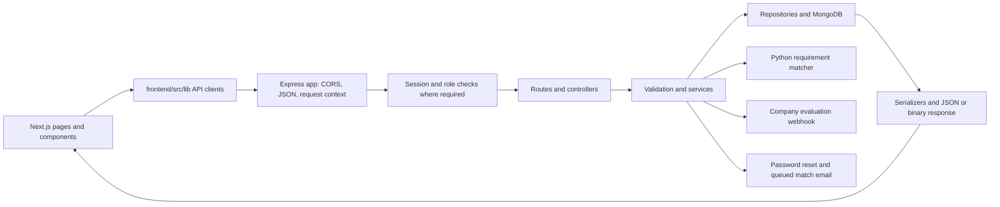

# API flow: frontend, backend and database mapping

This document maps the implemented code in `frontend/src` and `tor-backend/src`: browser actions, every mounted API route, payload fields, responses, MongoDB collections and write side effects. MongoDB uses collections and embedded documents rather than SQL tables; “table mapping” below refers to those collections. Fields are grouped where they share the same mapping. This is a source-code reference, not evidence that hosted services have been tested.

For n8n ingestion and TOR extraction/tag review, see [TOR document flow](tor_document_flow.md). Development and deployment instructions are in the [root README](../README.md).

## Request flow and shared conventions

| Convention | Implementation |
| --- | --- |
| Base URL | `NEXT_PUBLIC_API_BASE_URL`, default `http://localhost:4000`; Express routes start with `/api`. `frontend/src/lib/api.ts` resolves relative URLs. There are no Next.js API route handlers in this frontend. |
| JSON | Request bodies use `Content-Type: application/json`; Express accepts up to 1 MiB. Documents and thumbnails return bytes rather than JSON. |
| Human authentication | Browser sends `tor_access` and `tor_refresh` HttpOnly cookies with `credentials: include`. Cookies use `SameSite=Lax`, path `/`, and configured secure mode. JS does not read the tokens. |
| Session validation | Protected routes verify the access signature, load the current active/nondeleted user, and check that the referenced session is active and unexpired. Role/company access comes from the current database user. |
| Refresh | `fetchWithSessionRefresh` retries a protected request once after a 401 and successful `POST /api/auth/refresh`; concurrent refreshes share one frontend promise. `getSession` tries refresh when the session response has no user. |
| Worker authentication | Only `/api/ai/*` accepts `Authorization: Bearer <AI_REQUIREMENTS_TOKEN>`. Configured token must be at least 32 characters. This key does not authorize other routes. |
| IDs | `projectId` is an exact string, including plan prefixes and leading zeros. Database `_id`, company/user/tag/TOR foreign keys are BSON ObjectIds; JSON represents ObjectIds as strings. A foreign-key field named `torId` means `tor_announcements._id`, not `projectId`. |
| Dates | RSS `publishedAt`/`statusPublishedAt` are date-only strings. Application timestamps are commonly BSON Dates serialized as ISO strings. Imported contract date strings can differ; the TOR PATCH validator converts accepted application dates to BSON Dates. |
| Pagination | Common object: `{ page, limit, total, totalPages }`. TOR/match page is 1–100000; TOR limit 1–100, match limit capped at 50. Notifications use limit 1–50. |
| Errors | Shared handler returns `{ error: { code, message, requestId } }`; status distinguishes invalid input, authentication, permission, missing records, conflicts and dependency failures. Document handlers also return some direct errors without request IDs, or empty 404 bodies; thumbnails use empty 404 bodies. |

Access abbreviations used below: **Public** = no login middleware; **User** = active authenticated account; **Company** = `company_admin` or `company_member`, normally with a linked company; **Manager** = `project_manager` or `system_admin`; **Admin** = `system_admin`; **Worker** = scoped bearer token. Ownership checks still apply where indicated.

## Frontend action mapping

| Screen/component | Client and API calls | Data used or changed |
| --- | --- | --- |
| Home/session restore (`app/page.tsx`) | `authApi.getSession` → GET session, optionally POST refresh; `companyProfileApi.getMyCompanyProfile` → GET companies/me | Safe user becomes `SoftwareHouseProfile` through `userProfile.ts`; editable company data is then merged into that UI profile. |
| `AuthModal` | `authApi.register`, `login`, `forgotPassword` | Registration creates company/user/session; login issues cookies; reset request sends an email when configured and applicable. |
| `/reset-password` | `authApi.resetPassword` | URL token plus new password go to the backend; existing sessions are revoked after reset. |
| Discovery, `FilterBar`, `TORCard` | `torApi.listTors` → GET tors | Search is debounced 300 ms; page resets when filters change; results refresh every 30 seconds. Backend filtering/pagination precedes `toTorContract` display mapping. |
| Dashboard | `torApi.listTors({ limit: 100 })` and `dashboardApi.getDashboardStats` | Local TOR count/value/method metrics use only the fetched page, so they are incomplete beyond 100 projects. Other statistics are server aggregates. |
| Detail modal and notification/email project links | `torApi.getTor` → GET tors/:projectId | `?project=<id>` on home opens the linked project; inbox selection also loads current detail. |
| `PDFReader`, download action | Direct document preview/download URLs | Reader appends `?document=<sourceUrl>`, but the backend resolves the stored project URL and does not use that query value as the fetch target. |
| `PDFThumbnail` | Image URL `/api/thumbnail/:projectId` | Fetches current WebP bytes; component periodically refreshes its URL while mounted. |
| `SoftwareHouseProfileModal` | `tagApi.listTags`; `companyProfileApi.updateMyCompanyProfile` | User selects catalog service IDs and edits profile claims; backend synchronizes matching assignments. |
| `MatchingResultsView` | `matchingApi.getMatches` → GET matches | Shows rules coverage, requirement evidence, partial/missing clauses, and company evidence. Adds a display `contract` derived from each returned `tor`. |
| `AIEvaluationPanel` | `torEvaluationApi.getTorEvaluation`: GET evaluation; POST if missing or retrying a failed result; GET poll every 2.5 seconds while processing | Separate company-specific AI analysis, cached by company/project/input hash. Opening the panel can start evaluation automatically after a missing result. |
| `NotificationInbox`, home notification preference controls | `notificationApi`: list, mark read/all, read/update preferences | Loads inbox, changes read state, or sets email opt-in. |
| `MatchingSetupView` maintenance component | `tagApi`: list/create tags, save TOR assignments, list/review suggestions; `torApi.listBackendTors` | Role checks are also enforced by the backend. This component exists in source; the current home page renders `MatchingResultsView` for its matching tab. |
| Additional exported client helpers | `syncMyMatchingTags`, `getCompanyAssignments`, `saveCompanyAssignments` | Backend-supported operations; a client helper's presence does not establish a visible action in the current screen. Admin tag update/deactivate and worker ingestion are available through APIs without dedicated frontend clients. |

## Complete API route inventory

All paths below include the `/api` prefix. “Refresh matches” means recalculation and persistence in `company_matches`, with possible notification/email queue writes described later.

### Service and authentication

| Method and path | Access | Request fields | Response | Collection mapping / side effects |
| --- | --- | --- | --- | --- |
| GET `/api` | Public | None | `service, status, requestId` | No database write. |
| GET `/api/health` | Public | None | `status, service, database, timestamp` | MongoDB ping; no document write. |
| POST `/api/auth/register` | Public | Registration object below | 201 `{ user }` + auth cookies | Insert `companies`, insert/activate `users`, set company owner/member links, create `sessions`, best-effort `audit_logs`. Multi-step process, not a transaction. |
| POST `/api/auth/login` | Public | `email, password` | `{ user }` + cookies | Read user by normalized email; update login counters/timestamps, create session; audit. Bad passwords increment counters and can set `lockedUntil`. |
| POST `/api/auth/refresh` | Refresh cookie | No JSON fields required | `{ user }` + rotated cookies | Match refresh-token hash, check active user/session, update session hash, expiry and last use. |
| POST `/api/auth/logout` | Refresh cookie if present | None | `{ message }`, clear cookies | Revoke matching session and audit when present; still succeeds without a session. |
| POST `/api/auth/logout-all` | User | None | `{ message }`, clear cookies | Revoke all active sessions for current user; audit. |
| POST `/api/auth/forgot-password` | Public | `email` | Generic `{ message }` | When SMTP is configured and user exists: revoke older unused reset tokens, insert hashed reset token, send email; audit. Missing delivery configuration can fail the request. |
| POST `/api/auth/reset-password` | Public with reset token | `token, password` | `{ message }`, clear cookies | Consume valid unused token, replace password hash, update password/counter fields, revoke all user sessions; audit. |
| GET `/api/auth/session` | Public | Access cookie if present | `{ user: SafeUser or null }` | Read users/sessions when claims exist; invalid session returns 200 with null user. |
| GET `/api/auth/me` | User | None | `{ user }` | Read current user/session. |

Registration requires `firstName`/`lastName` (up to 80 characters), `email` (254), password (8–128), `termsAccepted: true`, and `company: { mode: "create", legalName }` (legal name 2–200). Optional fields: `phone` (32), `jobTitle` (120), and company `displayName` (2–200), `taxId` (32), `companySize` (80), `district` (120). Join input with `invitationToken` is recognized by validation but rejected by the service with `INVITATION_REQUIRED`; invitation joining is not implemented. Registration immediately activates/signs in the account; no verification-email route exists.

`SafeUser` fields: `id`, `email`, `profile.{firstName,lastName,phone,avatarUrl,jobTitle}`, `companyId`, `role`, `status`, `emailVerifiedAt`. Password hashes, refresh hashes, failed-login and lock fields are excluded. Logout/reset responses contain a message, not tokens.

### TOR discovery, documents and updates

| Method and path | Access | Input | Response | Collection mapping / side effects |
| --- | --- | --- | --- | --- |
| GET `/api/tors` | Public | Query fields below | `{ items: Tor[], pagination, facets, totalAllProjects }` | Read `tor_announcements`, resolve assignment labels from `tags`; no write. |
| GET `/api/tors/:projectId` | Public | String project ID | `{ tor }` | Find project and resolve tag labels. |
| PATCH `/api/tors/:projectId` | Manager | Editable fields below | `{ tor }` | `$set` supplied fields, `updatedAt`, `updatedByUserId`; refresh matches for this TOR across companies. Does not itself insert a `tor_versions` snapshot. |
| GET `/api/tors/documents/:projectId` | Public | String project ID | Inline PDF/HTML bytes | Read stored `documentUrl` or fallback `url`; fetch upstream. No database write. |
| GET `/api/tors/documents/:projectId/download` | Public | String project ID | PDF/HTML attachment | Same source resolution with attachment disposition. |
| GET `/api/thumbnail/:projectId` | Public | String project ID | WebP bytes or empty 404 | Join `thumbnails.projectId` to project; require thumbnail `sourceUrl === project.documentUrl`; base64 decode, `no-store`. |

| TOR list query field | Database mapping / behavior |
| --- | --- |
| `search` | All whitespace-separated terms must match somewhere in `projectId`, `title`, `description`, `departmentId`, `departmentName` as literal case-insensitive substrings. Maximum 160 characters / 12 words. |
| `departmentId` | Exact string; `__unknown__` matches missing/empty department. |
| `procurementMethod` | Compare string or normalized object `name`, `label`, `code`, `id`; `__unknown__` selects missing/empty. |
| `stage`, `stageScope` | Stage codes `P0,15,B0,D0,W0,D1,W1,D2,W2`; `latest` default resolves observations on `statusPublishedAt`, using the last code in that order on a tie. `retained` checks existence of the stored observation for that code. |
| `fromDate`, `toDate` | Inclusive `YYYY-MM-DD` range on `statusPublishedAt`; start must not exceed end. |
| `sort` | `latest`, `oldest`, `relevance`; default relevance when searching, latest otherwise. Ranking prioritizes exact project/department IDs and title/department text matches. |
| `status`, `category`, `sourceId` | Exact stored fields. |
| `tagIds` | Comma-separated or repeated strings, converted to ObjectIds; all must occur in `tagAssignments`. Query presence does not itself apply the serializer's matching-eligibility rules. |
| `organizationId` | Legacy/internal filter on `organization.organizationId` as ObjectId; separate from RSS department ID. |
| `minBudget`, `maxBudget` | Nonnegative bounds on numeric `budget.maxAmount`, falling back to `budget.minAmount`; no currency conversion. |
| `deadlineAfter` | `submissionDeadline >=` parsed date. |
| `page`, `limit` | Backend defaults 1/20; discovery client defaults 1/25. |

Facets are global counts over valid string project IDs, not the filtered page: `departments: [{ value, name, count }]`, `methods: [{ value, count }]`. `totalAllProjects` is also global; `pagination.total` is filtered.

PATCH allows only `title, description, summary, category, departmentName, publishedAt, submissionDeadline, projectStartAt, projectEndAt, sourceUrl, url, documentUrl, thumbnail, status, budget, documents`. Text accepts trimmed strings or null; publication must be a valid `YYYY-MM-DD`; application dates accept parseable dates or null. `budget` accepts `minAmount,maxAmount,currency,sourceText` or null, with finite nonnegative amounts and min ≤ max. Supplied budget replaces the stored budget object. `documents` replaces the grouped array; objects normalize `filename,sourceFormat,extractionStatus,pages,extractedText` while retaining extra attachment metadata and full text. `pages` may be a nonnegative count, extractor array or null. Status uses the nine stage statuses plus `multiple_announcements_same_day`.

Document proxy only fetches allowed e-GP hosts (`process.gprocurement.go.th`, `process5.gprocurement.go.th`), upgrades supported HTTP URLs to HTTPS, and validates redirects. PDFs pass through; HTML is decoded to UTF-8, given a base URL and sandboxed without scripts. Missing source: 404; denied host: 403; unsupported format: 415; unavailable upstream: 502. It does not persist downloaded documents.

### Company profiles and matching

| Method and path | Access | Input | Response | Collection mapping / side effects |
| --- | --- | --- | --- | --- |
| GET `/api/companies/me` | Company | Company ID from session | `{ company: CompanyProfile }` | Read company; join service tag IDs to catalog labels. |
| PUT `/api/companies/me` | Company | Company profile fields below | `{ company: CompanyProfile }` | Update profile and synchronized assignments; may create catalog tags; attempt match refresh. Profile remains saved if matching fails. |
| POST `/api/companies/me/matching-tags/sync` | Company | None | `{ linkedCapabilities }` | Rebuild profile-derived assignments and update company timestamp; attempt match refresh. |
| GET `/api/matches` | Company | `page,limit`, optional exact `projectId` | `{ resultType, engine, policyVersion, items, pagination }` | Recalculate all eligible projects for company, upsert matches, publish deduplicated notifications/queue email; filter and paginate returned compared records afterward. This GET writes data. |
| GET `/api/matches/ai-input` | Company | None | `{ schemaVersion,policyVersion,resultType,company,projects }` | Also calculates/persists matches and alerts; prepares separate AI-stage input without email/authentication data. |
| GET `/api/recommendations` | Company | None used | `{ resultType: "ai_recommendation", status: "not_configured", items: [], message }` | Placeholder; no AI recommendation provider call or write. |

| Profile API field | Stored field / transformation |
| --- | --- |
| `displayName` | `companies.displayName`, required 2–200 characters. |
| `description` | Optional, up to 2000; omission preserves existing value, null/blank clears to empty string. |
| `companySize` | Stored string, up to 80; blank/missing becomes `Not specified`, returned as empty string. |
| `district` | `companies.district`, up to 120; blank becomes null, response uses empty string. |
| `contactEmail` | `companies.contact.email`, validated email up to 254; preserves other contact properties. |
| `technologies` | Required string array, max 50 entries of 100 characters; case-insensitive deduplication. |
| `qualifications` | Required string array, max 100 entries of 200 characters; stored as qualification objects, retaining existing metadata for unchanged names; response reduces them to names. |
| `certifications` | Optional string array, max 100 entries of 200 characters; omission preserves stored array. |
| `tags` | Optional array of at most 50 `{ tagId }` links; only BSON tag IDs stored. Newly added IDs must exist and be active. Omission preserves links; `[]` clears them. Response joins `tagId,contractorLabel,text,category,type,status`. |
| Derived assignments | Exact technology/qualification entries and selected service tags become `tagAssignments` with source `manual`, verification `claimed`, review `approved`, confidence 1, self-report evidence and assignment timestamp; independent evidence is retained by merge rules. Company update uses a concurrency filter and returns 409 `PROFILE_CHANGED` on conflicting edits. |

`CompanyProfile` returns the editable fields above, with resolved tag labels; ownership/internal matching fields are not part of that profile response. Ownership comes from `users.companyId`; clients cannot choose another company ID on `/me`.

The Python matcher reads company technologies, qualifications, certifications and assignments; active/nonexcluded tags; TOR requirements; latest TOR versions; completed validated `ai_evaluations`. Requirement preference is current source-validated extraction, then the explicitly enabled protected demo, then usable stored TOR tag assignments. `aiExtractedRequirements` from the crawler are available to company AI analysis, but are not directly the Python requirement source.

Match fields include `torVersion,resultType,score,evidenceScore,dataMode,requirementMatches,counts,strengths,gaps,status,explanation,computedAt`; public items include serialized `tor` and omit internal company/TOR IDs and company-capability working data. Requirement matches include requirement ID/text/level, tag identity/name, status, coverage/evidence scores, source quote/URL/page, company evidence, verification level and component results. Counts cover `met,partial,missing,unassessed`. Frontend `matchingApi` adds `contract.properties` from requirements and marks a property fulfilled only for status `met`.

Required/preferred/informational weights are 3/1/0. Evidence weights are claimed 0.5, experienced 0.75, verified 1.0. Scores measure stored requirement coverage, not winning probability. Zero-score comparisons remain visible; `requirements_unavailable` records can be saved but are omitted from the compared-results list.

`/matches/ai-input` returns company `{ id,name,technologies,qualifications }`, with qualification evidence URLs when present; each project contains `projectId,torVersion,title,description,budget,submissionDeadline,sourceUrl,matching`. It is separate from the company evaluation webhook payload below.

### Tag catalog, assignments and suggestion review

| Method and path | Access | Input | Response | Stored changes |
| --- | --- | --- | --- | --- |
| GET `/api/tags` | Public | Optional `category,search` | `{ items }` | Read noninactive catalog; search text/name/provider label/aliases. |
| POST `/api/tags` | Admin | Catalog create fields below | 201 `{ tag }` | Insert active canonical tag and creator/timestamps. |
| GET `/api/tags/:tagId` | Admin | ObjectId string | `{ tag }` | Read active or inactive record. |
| PATCH `/api/tags/:tagId` | Admin | Catalog update fields | `{ tag }` | Update supplied fields and timestamp; preserve tag ID/references. |
| DELETE `/api/tags/:tagId` | Admin | ObjectId string | `{ tag }` | Soft-deactivate: `status: inactive`, timestamp. |
| GET `/api/tags/companies/:companyId` | User + own company or Admin | Company ObjectId | `{ assignments }` | Read assignments; returns `tagId,verificationLevel,evidence,reviewStatus,profileDerived`. |
| PUT `/api/tags/companies/:companyId` | User + own company or Admin | `{ assignments: [{ tagId,verificationLevel,evidence }] }` | `{ company }` | Replace company `tagAssignments` with manual approved entries; refresh company matches. Response is the repository company object, broader than profile serializer output. |
| PUT `/api/tags/tors/:projectId` | Manager | `{ assignments: [{ tagId,requirementLevel,evidence }] }` | `{ tor }` | Replace reviewed annotations with manual approved assignments; retain AI suggested/rejected entries; refresh TOR matches. |
| PUT `/api/tags/tors/:projectId/suggestions` | Manager | `{ suggestions: [{ tagId,requirementLevel,evidence,sourceDocumentUrl,sourcePage?,confidence }] }` | 202 `{ projectId,suggestions }` | Replace pending AI batch only; retain approved/rejected/manual entries. No match refresh here. |
| GET `/api/tags/tors/:projectId/suggestions` | Manager | Project ID | `{ projectId,suggestions }` | All AI-source assignments, including review history. |
| PATCH `/api/tags/tors/:projectId/suggestions/:suggestionId` | Manager, cannot review own submission | `{ reviewStatus: "approved" or "rejected" }` | `{ tor }` | Update pending suggestion status, reviewer/time and project timestamp. Approval refreshes TOR matches; rejection does not call refresh here. |

Catalog create accepts `text` (or legacy `name` alias), `category,type,contractorLabel?,aliases?,description?`. PATCH additionally accepts `status`, and requires at least one supported field. If both text/name appear in PATCH they must agree. Categories: `technology,skill,certification,industry,project_type,capability,requirement`. Intended tag types are `specification` and `contractor_requirement`; current human catalog validator requires a nonempty type string without enforcing that enum. `contractorLabel` is nullable/clearable and capped at 200; aliases max 20, deduplicated. Canonical uniqueness is category + text, with normalized duplicate checking in the repository. Response adds `name` as an alias for `text` and returns null for missing contractor label; existing extra stored fields may remain in returned tag objects.

Assignment arrays max 50, no duplicate tag IDs, nonempty evidence up to 2000 characters, active catalog IDs. TOR levels: `required,preferred,informational`. Company levels: `claimed,experienced`; only Admin may submit `verified`. Server adds source, confidence, review status, reviewer and assignment timestamps. Company assignment replacement replaces the full array, unlike profile synchronization's merge behavior.

Suggestion confidence must be finite 0–1. Source URL must exactly equal stored TOR document/announcement URL. `sourcePage` is optional text (up to 100), despite the broader frontend type allowing a number. Server adds `suggestionId,suggestedByUserId,suggestedAt,reviewedByUserId,reviewedAt,assignedAt`. Already-reviewed suggestions and duplicate approved tag classifications cause conflicts. Rejected suggestions do not affect matching. Crawler suggestions with completed processing/passed model review can be automatically eligible through separate checks; model review is not human approval. These APIs do not automatically reclassify every existing assignment when catalog labels change.

### Scoped AI requirement ingestion

These are backend worker APIs, distinct from the crawler's direct MongoDB writes in `ai-eval.json` and from company-specific evaluation.

| Method and path | Access | Input | Response | Collection mapping |
| --- | --- | --- | --- | --- |
| GET `/api/ai/tors/:projectId/source` | Worker | Project ID | `sourceId,projectId,torVersion,sourceUrl,documentHash,fetchedAt,pages` | Download current allowed-host PDF (max 20 MiB), extract page text, reuse/upsert `requirement_sources` snapshot and set TOR `requirementSource` pointer. This GET writes data. |
| POST `/api/ai/tors/:projectId/requirements` | Worker | Payload below | `projectId,torVersion,evaluationId,status: stored,requirements` (count), `unchanged,matchingRefreshed` | Transactionally resolve/create tags, upsert `ai_evaluations`, replace prior source-quote assignments and update TOR extraction pointer. Refresh matches after commit; false refresh flag does not roll back extraction. |

Payload: `{ sourceId, torVersion, model: { provider,name,version,promptVersion }, requirements: [...] }`. Model strings are required, max 150. Requirements max 100, each with unique `key` (100), `text` (2000), `importance` (required/preferred/informational), `confidence` (0.8–1), `evidence: { page,quote }`, and `clauses: [{ anyOf: [...] }]`. Each requirement has 1–20 AND clauses, each with 1–10 OR alternatives. Alternatives reference `{ tagId }` or propose `{ name,category,contractorLabel? }`; names max 120 and optional labels max 200.

Source ID/version must match the current source snapshot, project URL and current TOR version. Quote must match its cited integer page after normalization, with normalized quote length at least 15; tag text/alias must be supported by that quote. Inactive, excluded or flagged tags are rejected. Stored clauses use `anyOfTagIds: ObjectId[]`; assignments use `reviewStatus: validated`, `validationMethod: source_quote_v1`, evidence/source page/URL/snapshot and confidence. Same input hash is idempotent. Protected demo requirements cannot be overwritten by this route. PDF preparation has no OCR path and does not handle the crawler's HTML/ZIP extraction formats.

### Company-specific AI evaluation

| Method and path | Access | Input | Response | Collection mapping |
| --- | --- | --- | --- | --- |
| GET `/api/tors/:projectId/evaluation` | Company | Project ID; company from session | EvaluationResult below; 202 while processing, otherwise 200 | Load current company/TOR, compute input hash, read matching cached evaluation. Can mark an expired processing lease failed; also ensures the unique cache index. |
| POST `/api/tors/:projectId/evaluation` | Company | Same; no custom profile body | Same result/status codes | Reuse completed/processing record; otherwise start/retry a background webhook request and persist its result. Requires configured `TOR_EVALUATION_WEBHOOK_URL`. |

`EvaluationResult`: `{ status, evaluation, error }`, optionally `missingInformation`. Status: `missing,processing,completed,failed,insufficient_data`. Missing substantive company description/technology/qualification/certification/service or extracted TOR text returns insufficient data before generation. A changed profile/TOR input yields a new hash and cache record.

| Webhook payload group | Fields |
| --- | --- |
| Envelope | `schemaVersion: 1,evaluationPolicyVersion: 1,inputHash,requestId` |
| `company` | `companyId,name,legalName,description,companySize,district,qualifications,certifications,technologies,services[{tagId,text,contractorLabel,category,type}]`; contact email/password/session data excluded. |
| `tor` | `projectId,title,description,departmentName,procurementMethod,status,publishedAt,statusPublishedAt,budget,projectStartAt,projectEndAt,submissionDeadline,documentUrl,tags,extractedRequirements,documents` |
| TOR nested arrays | Tags: ID/text/level/evidence; extracted requirements: text/category/level/evidence (first 40); documents: filename/format/status/text/hash/truncation flag (first 20, shared 12,000-character text budget). Description and evidence fields are also capped by the service. |
| `limitations` | `companyInformationIsSelfReported,stageDoesNotConfirmOpenBidding,documentTextAvailable,documentTextTruncated,budgetAvailable` |

Webhook response must echo `schemaVersion: 1` and `inputHash`, include model name and `evaluation`. Evaluation fields: `summary,priceScore,priceAssessment,qualificationMatchScore,qualificationAnalysis,riskLevel,riskAnalysis,keyRequirementsExtracted,strengths,gaps,missingInformation`. Scores must be null or 0–100; risk is Low/Medium/High/Unknown. Backend attaches `aiModel,evaluatedAt`. Background completion updates cache status/evaluation/error/timestamps and removes the lease. Failure stores a bounded public error. This analysis does not update `company_matches` or create TOR requirements.

### Notifications and dashboard

| Method and path | Access | Input | Response | Collection mapping |
| --- | --- | --- | --- | --- |
| GET `/api/notifications` | User | `page,limit` | `{ items,unreadCount,pagination }` | Own in-app `notifications` with status sent/read; lookup TOR by internal torId to return string projectId. |
| PATCH `/api/notifications/:id/read` | User | Notification ObjectId | `{ message }` | Own sent notification → `status: read,readAt`; already-read is idempotent. |
| PATCH `/api/notifications/read-all` | User | None | `{ message }` | Update all own sent in-app notifications to read. |
| GET `/api/notifications/preferences` | User | None | `{ emailAlerts,emailAvailable }` | Read user opt-in and SMTP/feature configuration. |
| PATCH `/api/notifications/preferences` | User | Only `{ emailAlerts: boolean }` | Same preference shape | Set `users.notificationPreferences.matchEmailOptIn`, ensure channels/alert types, set `updatedAt`. Enabling requires configured email. Disabling does not remove the email channel, but false opt-in blocks delivery. |
| GET `/api/dashboard/stats` | Public | None | Dashboard fields below | Aggregate `company_matches,companies,ingestion_runs,sources,tor_announcements,tags`; no write. |

Notification item: `id,type,title,message,projectId,isRead,createdAt,readAt`. Type union includes new_match/tor_updated/deadline_reminder/system; the current automatic publisher creates new_match events. Preferences change does not send a test email.

Dashboard maps `matches.total` to match document count, `matches.avgScore` to average stored score rounded to one decimal, `matches.companiesMatched` to distinct company IDs in those records; `vendors` to company count; `crawl.runs`/`itemsFetched` to ingestion run count/sum of `itemsReceived`; `sources.count`/`names` to source records; `topDemand[{count,name}]` to top five tag assignment frequencies joined to tag text/name. These aggregates do not filter to positive matches or eligible tag assignments.

## Database collection and relationship map

This table covers collections referenced by the application paths above. It describes application fields and joins rather than every optional legacy/schema field. For full validators and indexes see [database schema](../database-design/docs/schema.md).

| Collection | Identity / relations | Fields read or written by these flows | Writers |
| --- | --- | --- | --- |
| `users` | `_id`; `companyId → companies._id` | `email,emailNormalized,passwordHash,displayName,profile.{firstName,lastName,phone,avatarUrl,jobTitle},role,companyId,status,registrationSource,emailVerifiedAt,lastLoginAt,failedLoginAttempts,lockedUntil,passwordChangedAt,termsAcceptedAt,deletedAt,createdAt,updatedAt`; `notificationPreferences.{channels,matchEmailOptIn,alertTypes,deadlineReminderDays}` | Auth and notification preferences. |
| `companies` | `_id`; `ownerUserId/memberUserIds → users._id`; `tags[].tagId` and `tagAssignments[].tagId → tags._id` | `legalName,displayName,taxId,companySize,district,description,contact.email,technologies,qualifications,certifications,tags,tagAssignments,verificationStatus,ownerUserId,memberUserIds,createdAt,updatedAt` | Registration, profile update/sync, assignment API. |
| `sessions` | `_id`; `userId → users._id` | `refreshTokenHash,status,userAgent,ipAddressHash,expiresAt,lastUsedAt,revokedAt,createdAt` | Login/register/refresh/logout/reset. |
| `auth_tokens` | `_id`; nullable user/company references | `type,tokenHash,userId,companyId,emailNormalized,expiresAt,usedAt,revokedAt,createdAt` | Password reset issuance/consumption; raw token is not stored. |
| `audit_logs` | `_id`; actor/target ObjectIds | `actorUserId,event,outcome,targetType,targetId,requestId,userAgent,ipAddressHash,metadata,createdAt` | Best-effort auth audit events. |
| `tor_announcements` | `_id` internal; `projectId` external string; embedded tag references | Discovery/source/stage fields documented in TOR flow; editable fields above; `documents,tagAssignments,aiTagSuggestions,aiExtractedRequirements,aiProcessing,requirementSource,requirementExtraction,updatedAt,updatedByUserId` | n8n collection/extraction; TOR PATCH; tag APIs; worker ingestion. |
| `tags` | `_id`; canonical `(category,text)` | `text,type,category,contractorLabel,aliases,description,status,conceptKey,matchingExcluded,createdByUserId,createdAt,updatedAt`; legacy name read alias | Admin catalog API, profile sync, worker ingestion, crawler AI flow. |
| `thumbnails` | Project string `projectId → tor_announcements.projectId` | `contentType,data` (base64), `sourceUrl,sourcePublishedAt,width,quality,size,updatedAt` | Collection workflow; backend reads only. |
| `tor_versions` | `torId → tor_announcements._id`, `version` | Latest version used for matching and source snapshot validation | Backend paths here read only; TOR PATCH does not create a version. |
| `requirement_sources` | `_id`; `(torId,torVersion,sourceUrl,documentHash)` snapshot key | `torId,torVersion,sourceUrl,documentHash,pages[{page,text}],resolvedUrl,fetchedAt,createdAt`; TOR pointer `requirementSource.{snapshotId,documentHash,sourceUrl,torVersion}` | Worker source preparation. |
| `ai_evaluations` | `(torId,torVersion)` | `status,retryCount,lastAttemptAt,nextAttemptAt,lastError,requirements,model,generatedAt,updatedAt,createdAt,inputHash,validation.{status,method,sourceId,sourceUrl,documentHash,validatedAt,dataMode}`; TOR pointer `requirementExtraction.{evaluationId,inputHash,sourceId,torVersion,updatedAt}` | Worker ingestion; read by rules matching. Separate from company evaluation. |
| `company_matches` | `(companyId,torId,torVersion)`; company/TOR ObjectIds | Rules output including `resultType,score,evidenceScore,dataMode,requirementMatches,counts,strengths,gaps,status,explanation,companyCapabilities,computedAt,createdAt,updatedAt`; obsolete recommendation removed on requirement-match writes | Matching GETs, profile/TOR changes, alert scanner. |
| `company_tor_evaluations` | Unique `(companyId,projectId,inputHash)`; internal `torId` | `status,requestId,leaseExpiresAt,evaluation,error,createdAt,updatedAt,completedAt` and key fields | Company evaluation service/background webhook completion. |
| `notifications` | `_id`; unique `eventKey`; user/company/TOR references | `eventKey,userId,companyId,torId,type,channel,status,title,message,attemptCount,nextAttemptAt,deliveryError,createdAt,sentAt,readAt` | Match publisher, notification read APIs. |
| `match_email_outbox` | Deterministic string `_id` per user/company/TOR/version | `userId,companyId,torId,torVersion,projectId,title,score,status,attempts,nextAttemptAt,createdAt,leaseExpiresAt,sentAt,errorCode` | Match email queue and delivery worker. |
| `match_alert_state` | String IDs for scan-lock, baseline, project state | `owner,expiresAt` for lease; `fingerprint,checkedAt` per project; `initializedAt` baseline | Background alert scanner; no public endpoint. |
| `ingestion_runs` | `_id`; source identifier `sourceId` | Fetch counts/coverage/request metadata described in TOR flow; dashboard sums `itemsReceived` | n8n collection; backend reads only. |
| `sources` | `_id`, source catalog `code/name` | `name,code` used by dashboard | Provisioned externally; backend reads only. |

Main joins: user → company; company service/assignment → tag; TOR assignment → tag; matching/evaluation/source/version/notification → internal TOR `_id`. Browser discovery, documents, thumbnails and company AI evaluation use external string project IDs. `sourceId` is context-dependent: crawler source identifier (for example EGP) versus worker API source snapshot ObjectId; do not substitute one for the other.

## Stored fields to frontend display fields

| Backend/API field | Frontend model / use |
| --- | --- |
| `SafeUser.id,email,companyId,role,profile` | `safeUserToProfile` account identity/contact; company profile is loaded separately. |
| Profile `displayName,description,companySize,district,contactEmail,technologies,qualifications,certifications,tags` | `companyDataToProfile` / `profileToCompanyData` bridge profile modal state and profile API. Only tag IDs are submitted as selected service links. |
| TOR `projectId` | Both `TORContract.id` and `projectId`; encoded in endpoint paths. |
| `title` | UI title, fallback `Untitled TOR announcement`. |
| `departmentName`, then `sourceId` | `contractOwner`, fallback e-GP; department identity also retained separately. |
| `budget.maxAmount`, fallback `minAmount` | `price`; `priceFormatted` as THB or Not specified. |
| `projectStartAt,projectEndAt,publishedAt,submissionDeadline` | `startDate,endDate,postingDate/publishedAt,submissionDeadline`; missing contract dates become empty strings. |
| `procurementMethod` | Display `category` using string or object name/label/code/id, fallback Government procurement. Original method also retained. |
| `documentUrl`, fallback `url` | `pdfUrl`; PDFReader uses backend proxy rather than connecting to MongoDB. |
| Eligible `tagAssignments` | `properties` from evidence/level, required flag for required level; deduplicated `tags[{id,text}]` from tag ID/label. Serializer filters assignments before frontend mapping. |
| `documents,stageObservations,status,statusPublishedAt,statusOrderAmbiguous,biddingOpenVerified` | Preserved in project detail/stage/source presentation. Other retained identity/provenance fields pass through `toTorContract`. |
| Project ID | Thumbnail URL reconstructed as `/api/thumbnail/<encoded ID>`. Stored base64 never appears in TOR JSON as the image payload. |
| Company evaluation response | `AIEvaluationPanel` renders server result directly. `toTorContract.aiEvaluation` contains placeholder defaults and is not a persisted AI result. |

TOR serializer removes MongoDB `_id`, retired top-level `templateId,projectKey,announcementType`, and working `matchingVersion,matchingRequirements`. It also removes retired opend/location enrichment fields (`opend,opendLookup,province,district,subdistrict,projectLocation,projectMoney,referencePrice,totalContractValue,contractProjectStatus,contracts,opendUpdatedAt,locationFilter`). Other stored TOR properties are spread into the result; it is not a strict allowlist serializer. Documents retain extracted text and extra normalized metadata.

## Background writes and consistency boundaries

Match recalculation publishes only positive compared matches for eligible active users. Award/cancelled-award/amended-award and cancelled-invitation projects are excluded by the alert publisher. In-app `eventKey` and email outbox ID deduplicate by user/company/TOR/version; repeated match reads preserve existing notification read state. Email opt-in plus feature/SMTP configuration is required; delivery rechecks user, project and current match. Outbox transitions include queued → sending → sent, cancelled, failed or uncertain; only definite connection failures retry, up to three attempts.

The running backend starts a database-change scanner and email delivery loop. Scanner uses `match_alert_state` lease/baseline/fingerprints, reads tags/TORs and refreshes changed projects. This is how externally written crawler data can lead to refreshed matches and alerts without a browser request. See [automatic alerts](../tor-backend/docs/automatic-match-alerts.md) for polling settings and first-run behavior.

Only scoped requirement ingestion wraps its tag/evaluation/TOR writes in a MongoDB transaction; matching refresh occurs afterward. Registration, company profile tag resolution, match/notification writes and asynchronous company evaluation span multiple operations. A request error can follow an earlier committed write. Profile updates deliberately remain successful when the subsequent matcher is unavailable. Company evaluation is an in-process background task with a persisted lease, not a durable job queue; later requests detect expired leases.

## Source map for maintenance

| Concern | Source |
| --- | --- |
| Mounted route groups and common middleware | [app.mjs](../tor-backend/src/app.mjs), [routes](../tor-backend/src/routes) |
| Request validation | [validators](../tor-backend/src/validators), [worker payload validation](../tor-backend/src/services/ai-requirement-validation.mjs) |
| Database reads/writes | [repositories](../tor-backend/src/repositories), [requirement ingestion](../tor-backend/src/services/ai-requirement-ingestion.mjs), [company evaluation](../tor-backend/src/services/company-tor-evaluation.mjs) |
| Response mapping | [serializers](../tor-backend/src/serializers), [TOR frontend adapter](../frontend/src/lib/torApi.ts), [profile frontend adapter](../frontend/src/lib/userProfile.ts) |
| Frontend callers | [API clients](../frontend/src/lib), [home page](../frontend/src/app/page.tsx), [components](../frontend/src/components) |
| Matching engine | [matching service](../tor-backend/src/services/requirement-matching.service.mjs), [requirement selection](../tor-backend/src/services/requirement-input.mjs), [Python engine](../tor-backend/matching/engine.py) |
| Detailed contracts | [authentication](../tor-backend/docs/authentication-contract.md), [worker handoff](../tor-backend/docs/ai-requirements-handoff.md), [company evaluation](../tor-backend/docs/company-tor-evaluation.md), [notifications](../tor-backend/docs/notifications.md) |
